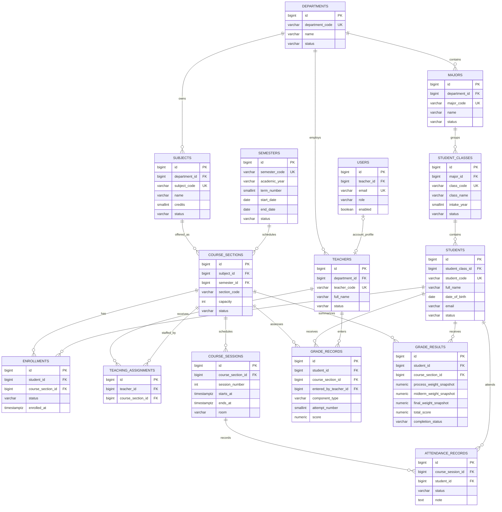

# University Database Design Proposal (ERD)

## 1. Document status

- Status: **proposed design – pending business-rule confirmation**.
- Baseline: GitHub `main` of `NTMHuy/Student_management_final`.
- Work branch: `feature/university-student-management`.
- This document does not modify the database and does not authorize a production migration.
- Existing Flyway migrations V1–V3 are historical; do not edit them. The university schema must be introduced through new migrations after this design is approved.

## 2. Design principles

1. Separate the student's stable cohort from a semester-specific course offering.
2. A subject is catalog data; a course section is one offering of that subject in one semester.
3. Enrollment is the explicit relationship between a student and a course section.
4. Attendance and grades must be validated against enrollment.
5. Teacher permissions must be validated against teaching assignments, not homeroom-teacher ownership.
6. Keep grade calculation on the backend and preserve the confirmed weight snapshot.
7. Keep historical academic records when students, teachers, subjects, or course sections become inactive. Prefer status changes and restrictive foreign keys over cascading deletion of academic history.

## 3. Proposed entity relationship diagram

The diagram shows the recommended direction. Optionality and a few lifecycle details remain subject to the decisions in section 8.

## 4. Table responsibilities and constraints

### 4.1 Departments and majors

**departments**
- Represents an academic faculty/department or organizational unit, not a free-text subject group.
- Suggested fields: `id`, `department_code`, `name`, `description`, `status`, timestamps.
- `department_code` must be unique.

**majors**
- Represents an academic major/program.
- Proposed relation: one department has many majors; each major belongs to one department.
- Suggested fields: `id`, `department_id`, `major_code`, `name`, `description`, `status`, timestamps.
- `major_code` must be unique.

This is a recommended starting point. If the institution allows a major to be jointly managed by multiple departments, this relation must be replaced with a many-to-many association.

### 4.2 Student classes and students

**student_classes**
- Stable cohort/class grouping, e.g. `CNTT-K20A`.
- Proposed fields: `id`, `major_id`, `class_code`, `class_name`, `intake_year`, `status`, timestamps.
- Do not include grade level, school stream, homeroom teacher, or class leaders.
- Capacity is not assumed here; course-section capacity is a separate concept.

**students**
- Proposed fields: `id`, `student_code`, `full_name`, `date_of_birth`, `gender`, `email`, `phone`, `student_class_id`, `status`, `notes`, timestamps.
- `student_class_id` is the student's current stable cohort membership.
- Do not carry forward `parent_email` as a required university profile field.
- Whether date of birth and gender remain mandatory must be confirmed against the institution's data policy.

If students can change major/cohort and the institution needs full historical tracking, use a separate student-class membership history table instead of overwriting `student_class_id`.

### 4.3 Subjects, semesters, and course sections

**subjects**
- Catalog record independent of a semester.
- Proposed fields: `id`, `subject_code`, `name`, `department_id`, `credits`, `description`, `status`, timestamps.
- Remove `periods_grade10/11/12`, `head_teacher_id`, and K-12 evaluation type.
- Do not store a single teacher on a subject; teachers are assigned to course sections.

**semesters**
- Represents a semester within an academic year.
- Proposed fields: `id`, `semester_code`, `academic_year`, `term_number`, `start_date`, `end_date`, `registration_start_at`, `registration_end_at`, `status`.
- Candidate unique constraint: `(academic_year, term_number)`.

**course_sections**
- One offering of one subject in one semester.
- Proposed fields: `id`, `subject_id`, `semester_id`, `section_code`, `capacity`, `status`, optional enrollment window and schedule summary, timestamps.
- Candidate unique constraint: `(semester_id, section_code)`.
- Whether `section_code` is unique globally or only within a semester must be finalized.
- Do not duplicate subject name/code as authoritative data; return them through joins or API DTOs.

### 4.4 Enrollments

**enrollments**
- Resolves the many-to-many relationship between students and course sections.
- Proposed fields: `id`, `student_id`, `course_section_id`, `status`, `enrolled_at`, `withdrawn_at`, `finalized_at`, timestamps.
- Candidate uniqueness: one enrollment row per `(student_id, course_section_id)`; re-enrollment behavior must be decided before finalizing this constraint.
- Attendance and grade writes must require an eligible enrollment status.
- Do not infer enrollment from the student's student class.

### 4.5 Teachers, accounts, and teaching assignments

**teachers**
- Retain teacher profile and teacher code.
- Replace free-text `department` with `department_id` if department entities are approved.
- Review `subject_taught`: it is descriptive legacy data and should not drive authorization.

**users**
- Retain account authentication and ADMIN/TEACHER roles for the first university release.
- Preserve the one-to-one optional teacher profile relation for TEACHER accounts.
- ADMIN accounts may have no teacher profile.

**teaching_assignments**
- Proposed fields: `id`, `teacher_id`, `course_section_id`, optional `assignment_role`, timestamps.
- Candidate unique constraint: `(teacher_id, course_section_id)`.
- Teacher access to a course section is derived from this table.
- Whether a section can have multiple teachers and whether one is lead teacher needs confirmation.

### 4.6 Course sessions and attendance

**course_sessions**
- One scheduled meeting of a course section.
- Proposed fields: `id`, `course_section_id`, `session_number`, `starts_at`, `ends_at`, `room`, `status`, timestamps.
- Candidate unique constraint: `(course_section_id, session_number)`.
- Store actual start/end timestamps to support timetable and attendance history. Recurrence generation is a separate feature.

**attendance_records**
- Proposed fields: `id`, `course_session_id`, `student_id`, `status`, `note`, `recorded_by_teacher_id`, timestamps.
- Candidate unique constraint: `(course_session_id, student_id)`.
- A student must have an eligible enrollment in the course section that owns the session.
- Retain current statuses PRESENT, EXCUSED, UNEXCUSED, LATE only if the university confirms they meet its policy.

### 4.7 Grade records and results

**grade_records**
- One component score attempt.
- Proposed fields: `id`, `student_id`, `course_section_id`, `component_type`, `attempt_number`, `score`, `note`, `entered_by_teacher_id`, timestamps.
- `component_type`: PROCESS, MIDTERM, FINAL.
- `score`: numeric range 0–10.
- PROCESS allows multiple attempts; MIDTERM and FINAL each allow one attempt.
- Candidate unique constraint: `(student_id, course_section_id, component_type, attempt_number)`.
- Enforce MIDTERM/FINAL attempt_number = 1 in validation and preferably a database check.

**grade_results**
- One result summary per student per course section.
- Proposed fields: `id`, `student_id`, `course_section_id`, `process_weight_snapshot`, `midterm_weight_snapshot`, `final_weight_snapshot`, `process_average`, `midterm_score`, `final_score`, `total_score`, `completion_status`, `calculated_at`, timestamps.
- Candidate unique constraint: `(student_id, course_section_id)`.
- Snapshot weights total 100%.
- PROCESS average is computed from all valid PROCESS attempts.
- No final total is produced until all required components are present.
- Weight snapshot is immutable once the result has been established, unless an explicit audited correction workflow is introduced.
- Backend is authoritative; frontend displays the result but does not calculate the persisted total.

A separate `grade_components` configuration table is not proposed initially because the three component types are fixed by the currently confirmed MVP rules. Add a configuration table only if component types or per-section grading structures must become configurable.

## 5. Relationship and deletion policy

Recommended defaults, subject to confirmation:

- Academic records (enrollments, attendance, grades) should not cascade-delete when a student or course section is removed.
- Prefer soft deactivation for departments, majors, subjects, semesters, student classes, course sections, teachers, and students.
- Use `ON DELETE RESTRICT` for referenced academic master data once academic activity exists.
- `ON DELETE CASCADE` may be acceptable for purely dependent draft configuration only if it cannot erase published academic records.
- Keep timestamps and actor IDs for grade/attendance changes; consider audit history if the institution requires traceability.

## 6. Migration strategy

Do not rewrite V1–V3. A safe migration sequence on the feature branch is expected to be:

1. Create new university master tables: departments, majors, student_classes, semesters.
2. Add university profile relations/fields to students and teachers without dropping legacy columns.
3. Create course_sections, enrollments, and teaching_assignments.
4. Create course_sessions and new attendance records (or a versioned replacement table).
5. Create course-section grade records/results with the confirmed grading constraints.
6. Add indexes, unique constraints, and foreign keys after validating data assumptions.
7. Update application code to use the university schema.
8. Decide separately whether old school data is archived, transformed, or excluded.
9. Only after local migration and test validation, prepare a production migration plan. Do not execute against Railway without explicit approval.

The exact V numbers must be read from the target branch immediately before creating migrations; never assume the sequence based only on an earlier inspection.

## 7. API impact summary

- Student profile references `studentClassId`, and may expose major/department through the student class relation.
- Student class endpoints manage stable cohort records.
- Course-section endpoints manage semester-specific subject offerings.
- Enrollment endpoints manage student registration and withdrawal.
- Teaching assignment endpoints use `teacherId` + `courseSectionId`.
- Attendance endpoints read/write by `courseSessionId`.
- Grade endpoints read/write by `courseSectionId` and expose attempts, weights, completion, and result.
- Teaching options return only course sections the current teacher is assigned to; admins may access all active sections.

## 8. Business decisions required before schema freeze

The following are not confirmed in the current project context. The recommendations are deliberately separated from confirmed decisions.

| Topic | Recommended MVP default | Needs owner confirmation |
|---|---|---|
| Department and major | Separate entities; each major belongs to one department | Whether a major may belong to multiple departments |
| Cohort/intake | Store intake year on student class; no separate cohort table initially | Whether cohorts are managed independently of student classes |
| Student movement | Keep current student_class_id for MVP | Whether historical class/major transfers must be tracked |
| Semester | Academic year + term number + start/end and registration dates | Number of semesters per year and allowed date overlaps |
| Course capacity | Capacity is optional/nullable; reject new enrollments when full if set | Whether over-enrollment or waitlist is required |
| Prerequisites | No prerequisite enforcement in first MVP | Whether prerequisite subjects must be modeled |
| Enrollment lifecycle | ACTIVE, WITHDRAWN, COMPLETED; FAILED is a grade outcome, not enrollment status | Whether re-enrollment creates a new row or reactivates the old row |
| Course sessions | Explicit session rows with start/end and room | Whether recurring timetable generation and conflict detection are in MVP |
| Teachers per section | Allow multiple teachers; assignment can have a role | Whether exactly one lead teacher is required |
| Grade scale | Keep numeric 0–10 only for MVP | Whether letter grades, GPA, classification, and academic standing are needed |
| Student profile | Keep student code, name, gender, contact, status; make date of birth optional unless policy requires it | Required personal fields and student email uniqueness |
| Old school records | Preserve legacy data until a retention/archival decision | Archive, convert, or exclude existing school records |

## 9. Explicit non-goals for the first implementation pass

- Automatic prerequisite checking.
- Waitlist and over-capacity enrollment.
- GPA/letter-grade conversion.
- Timetable conflict detection.
- Automated recurring-session generation.
- Multi-department majors.
- Full student academic-history workflow, unless confirmed as a required core feature.

These can be added later without weakening the initial distinction between student classes and course sections.
