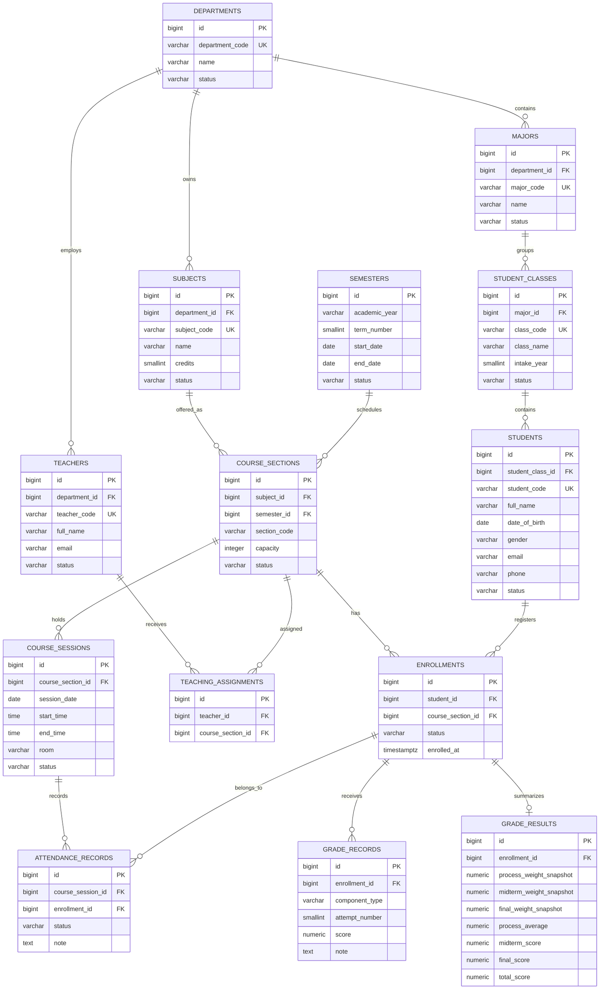

# University Database Design – ERD Proposal

> Status: approved MVP baseline. The project owner approved the ten policy defaults in section 6. This document describes the target model; production rollout still requires migration validation and explicit approval.

## 1. Design principles

1. Separate the student's stable cohort from a semester-specific course offering.
2. A subject is catalog data; a course section is one offering of that subject in one semester.
3. Enrollment is the relationship between a student and a course section.
4. Grades and attendance must reference that enrollment/course section, never only a student class and subject.
5. A teacher's permissions come from teaching assignments to course sections.
6. Preserve historical academic results when catalog settings or grading weights change.
7. Keep the existing authentication foundation and ADMIN / TEACHER roles for the first release.
8. Evolve the existing Flyway schema with additive migrations; do not rewrite V1–V3.

## 2. Logical ER diagram

## 3. Proposed tables and constraints

### 3.1 departments

Purpose: institutional organizational unit, e.g. Khoa Công nghệ thông tin.

Suggested fields:
- `id` BIGINT identity primary key
- `department_code` VARCHAR(20) unique, not null
- `name` VARCHAR(150) not null
- `description` TEXT nullable
- `status` ACTIVE / INACTIVE
- timestamps

### 3.2 majors

Purpose: academic program/major, e.g. Công nghệ phần mềm.

Suggested fields:
- `id` primary key
- `department_id` FK to departments, not null
- `major_code` unique, not null
- `name`, `description`, `status`, timestamps

Recommended constraint: a major belongs to one department. This is a design recommendation, not yet a confirmed institutional rule.

### 3.3 student_classes

Purpose: stable student cohort/class, e.g. CNTT-K20A.

Suggested fields:
- `id` primary key
- `major_id` FK to majors
- `class_code` unique, not null
- `class_name` not null
- `intake_year` SMALLINT
- `status` ACTIVE / ARCHIVED
- timestamps

Do not put semester, subject, teacher, grade level, school stream, homeroom teacher, or class leaders here. Capacity is not required for a cohort unless the institution needs it.

### 3.4 students

Purpose: student identity/profile.

Suggested fields:
- `id` primary key
- `student_code` unique, not null
- `student_class_id` FK to student_classes
- `full_name` not null
- `date_of_birth` NOT NULL (approved: required)
- `gender` using the existing supported values, subject to review
- `email` nullable/unique according to institutional policy
- `phone`, `address`, `notes`
- `status`: ACTIVE / SUSPENDED / GRADUATED / WITHDRAWN are candidates; exact lifecycle needs approval
- timestamps

Remove `parent_email` from the university core profile. The current one-class-at-a-time rule is represented by `student_class_id`. If historical class transfers must be audited, introduce a separate membership-history table in a later design revision rather than overloading the current field.

### 3.5 teachers

Retain teacher identity/profile and account linkage. Recommended change:
- Replace free-text `department` with `department_id` FK if department records are approved.
- Keep teacher code, name, gender, DOB, email, phone, degree, title, status, notes.
- Remove `subject_taught` as an authorization or assignment mechanism; actual teaching responsibility is represented by teaching_assignments.

### 3.6 subjects

Purpose: reusable subject catalog, e.g. Lập trình Java.

Suggested fields:
- `id`, `subject_code` unique, `name`
- `department_id` FK to departments
- `credits` SMALLINT with CHECK (credits > 0)
- `description`, `status`, timestamps

Remove `periods_grade10/11/12`, `head_teacher_id`, and K-12 evaluation type. Whether subjects need prerequisite relations should be decided separately.

### 3.7 semesters

Purpose: academic term catalog.

Suggested fields:
- `id`
- `academic_year` VARCHAR(9), e.g. 2026-2027
- `term_number` SMALLINT, proposed 1/2/3
- `name` optional display label
- `start_date`, `end_date`
- registration start/end dates only if enrollment windows are required
- `status`: PLANNED / OPEN / IN_PROGRESS / COMPLETED / ARCHIVED are candidates
- unique `(academic_year, term_number)`

The number of terms per year and status transitions require institutional confirmation.

### 3.8 course_sections

Purpose: one semester offering of a subject, e.g. Lập trình Java – Nhóm 01 – HK1.

Suggested fields:
- `id`
- `subject_id` FK to subjects
- `semester_id` FK to semesters
- `section_code` (unique within semester; recommended unique `(semester_id, section_code)`)
- `section_name` optional
- `capacity` nullable or positive integer
- `registration_open_at`, `registration_close_at` only if needed
- `status`: DRAFT / OPEN / IN_PROGRESS / COMPLETED / CANCELLED are candidates
- timestamps

A course section may have one or more teachers through teaching_assignments. It must not be conflated with student_classes.

### 3.9 enrollments

Purpose: record a student's registration in a course section.

Suggested fields:
- `id`
- `student_id` FK to students
- `course_section_id` FK to course_sections
- `status`: proposed REGISTERED / ACTIVE / WITHDRAWN / COMPLETED / FAILED
- `enrolled_at`, `withdrawn_at`, timestamps
- unique `(student_id, course_section_id)`

This design allows a student to take many course sections and many students to join one section. Whether re-enrollment/repeat attempts require multiple historical enrollment rows is unresolved. Do not impose a one-attempt-only policy until confirmed.

### 3.10 teaching_assignments

Purpose: authorize teachers for course sections.

Suggested fields:
- `id`
- `teacher_id` FK to teachers
- `course_section_id` FK to course_sections
- optional `assignment_role` (e.g. lecturer/assistant) only if required
- `created_at`
- unique `(teacher_id, course_section_id)`

Teacher access checks must be enforced server-side against this table. Frontend filtering is not authorization.

### 3.11 course_sessions

Purpose: a dated teaching session within a course section.

Suggested fields:
- `id`
- `course_section_id` FK to course_sections
- `session_date` DATE
- `start_time`, `end_time`
- `room` nullable
- `status`: SCHEDULED / COMPLETED / CANCELLED are candidates
- timestamps

A session is the unit used for attendance. Recurring timetable templates are not included in the MVP proposal; create dated sessions directly unless recurring scheduling is explicitly required.

### 3.12 attendance_records

Purpose: attendance of an enrolled student for one course session.

Suggested fields:
- `id`
- `course_session_id` FK to course_sessions
- `enrollment_id` FK to enrollments
- `status`: PRESENT / EXCUSED / UNEXCUSED / LATE (candidate set)
- `note`
- `recorded_by` FK to users or teachers, depending on audit convention
- timestamps
- unique `(course_session_id, enrollment_id)`

Validate that the enrollment belongs to the same course section as the session. Prefer an application service validation or a composite FK if the chosen key design supports it.

### 3.13 grade_records

Purpose: individual score attempts for an enrollment.

Suggested fields:
- `id`
- `enrollment_id` FK to enrollments
- `component_type` PROCESS / MIDTERM / FINAL
- `attempt_number` positive SMALLINT
- `score` NUMERIC(4,2), CHECK 0 <= score <= 10
- `note`
- `recorded_by` audit reference
- timestamps
- unique `(enrollment_id, component_type, attempt_number)`

Confirmed rules:
- PROCESS may have multiple attempts and the component score is their average.
- MIDTERM and FINAL each have exactly one score (attempt_number = 1).
- The database can enforce attempt_number = 1 for MIDTERM/FINAL with a CHECK constraint.
- A missing component remains missing; do not compute a final total until all three component values exist.

### 3.14 grade_results

Purpose: saved/calculated grade summary for an enrollment.

Suggested fields:
- `id`
- `enrollment_id` unique FK to enrollments
- `process_weight_snapshot`, `midterm_weight_snapshot`, `final_weight_snapshot` (percentage or decimal; choose one representation consistently)
- `process_average`, `midterm_score`, `final_score`
- `total_score` nullable until all components exist
- `calculated_at`, timestamps

The three weight snapshots must sum to 100 (if percentages) and remain immutable for the saved result unless an explicit grade-recalculation workflow is approved. Store the component scores used for the result so historical display is stable. The backend is authoritative for calculation and validation.

## 4. Main relationship and validation rules

- A student belongs to one student class at a time.
- A student can have many enrollments.
- A course section belongs to exactly one subject and one semester.
- A subject can be offered in many semesters and course sections.
- A course section can have many enrolled students and one or more assigned teachers.
- Attendance requires an active/eligible enrollment and a session belonging to the enrollment's course section.
- Grade records require an eligible enrollment and a teacher/admin authorized for that course section.
- A teacher can access only course sections present in their teaching assignments; ADMIN can access institution-wide records.
- Historical grades preserve the weights and component values used at calculation time.

## 5. Explicitly out of initial schema scope

Unless separately approved:
- K-12 grade levels, school streams, homeroom teachers, and class leaders.
- Automatic tuition/payment management.
- Library, dormitory, transportation, and student disciplinary modules.
- Automatic prerequisite enforcement.
- GPA/letter-grade conversion and academic standing.
- Recurring timetable templates and automatic conflict detection.
- Automatic student-class promotion.

## 6. Approved MVP policy defaults

The project owner approved these ten defaults:

1. Departments and majors are separate tables; each major belongs to one department.
2. A student class identifies a major and intake year.
3. An academic year supports term 1, term 2, and summer term 3.
4. ADMIN/staff manage enrollment in the first release; student self-registration is not included.
5. Students may repeat a subject in another semester; each course-section enrollment is retained separately.
6. Course-section capacity is required and must be enforced when enrolling.
7. Schedule is managed as dated course sessions; recurring schedule generation is out of MVP.
8. Grading weights are configured per course section and snapshotted into the saved result.
9. MVP stores the current student class only; class-transfer history is deferred.
10. Student email is optional; date of birth is required.

Implementation notes:
- The current unique key `(student_id, course_section_id)` permits one enrollment per student in a specific course section, while allowing a repeat in a different semester/course section.
- Student self-service enrollment endpoints must not be exposed in MVP.
- Capacity enforcement must be transactional to prevent concurrent registrations from exceeding capacity.
- The schema currently leaves `students.student_class_id` nullable to preserve legacy school records during transition. New university student creation must require it; making the column globally NOT NULL requires an approved legacy-data reconciliation.

## 7. Migration strategy and current implementation status

The current main branch has school-oriented V1–V3 migrations. Do not edit them. Migration V4 has been added on the feature branch as an additive university schema. It has not been run against Railway. Before treating it as ready for deployment, validate it against a disposable PostgreSQL database and implement matching JPA entities, repositories, services, controllers, and tests. Next steps:

1. Add new Flyway migration(s) to create university tables and indexes.
2. Decide whether old `classes`, `class_leaders`, and old school grade/attendance data remain as legacy tables, are archived, or are transformed.
3. Introduce new university entities alongside legacy tables during the transition if preserving existing data is required.
4. Update repositories/services/controllers and authorization to use the new model.
5. Update frontend API types and modules only after the backend contract is stable.
6. Run migrations and tests against a disposable local/test PostgreSQL database first.
7. Do not run migrations against Railway production without explicit approval and a backup/rollback plan.
